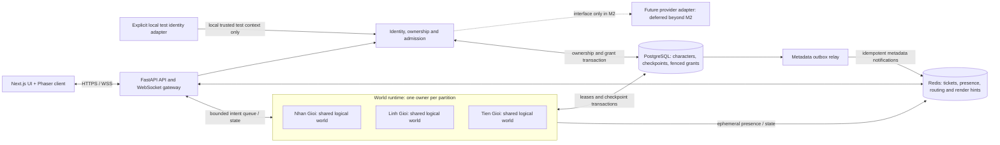
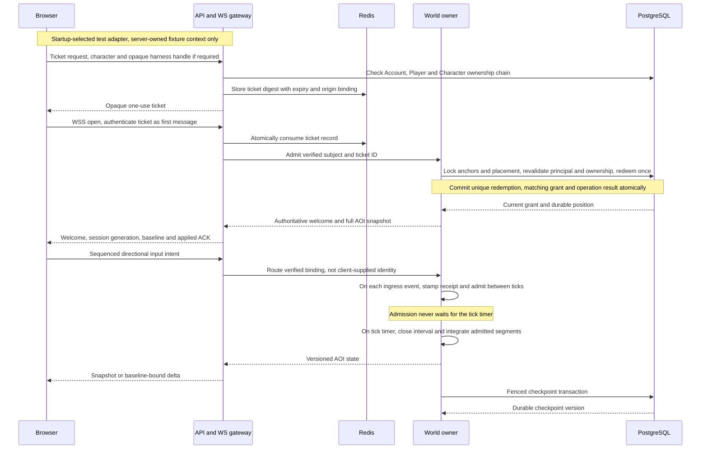
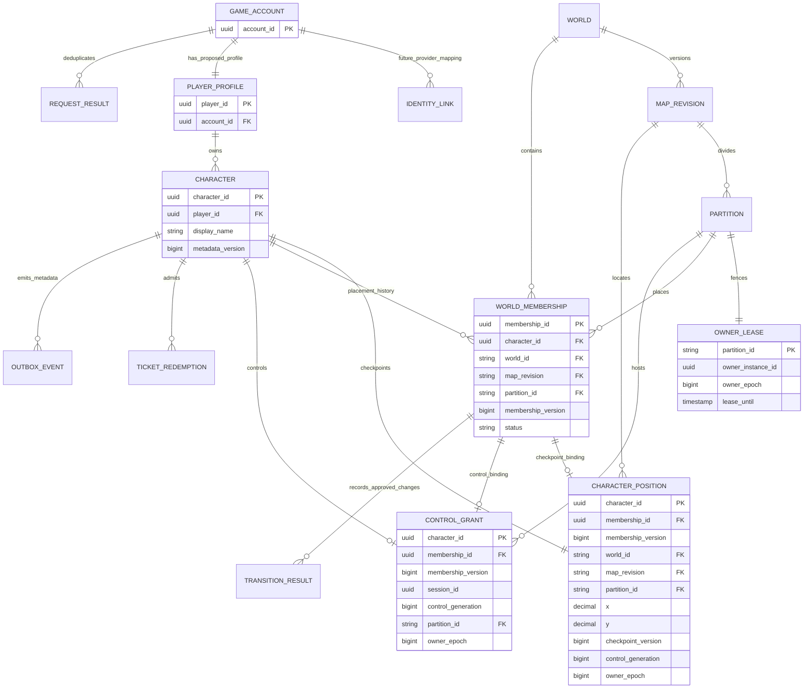
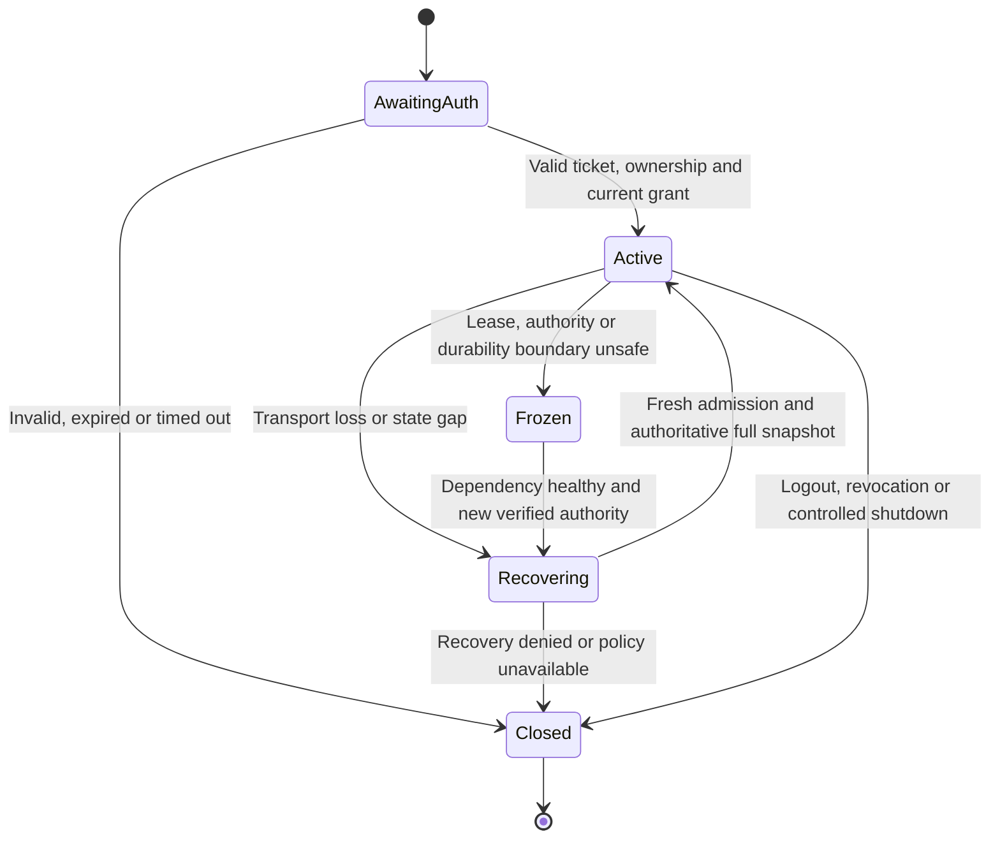

# M2 — World & Player System architecture

Status: **PROPOSED / DESIGN ONLY**. M1 is [accepted PASS](M1_ACCEPTANCE.md). No M2 code, schema, Redis service or migration exists as a result of this document. Implementation gate: **CLOSED until independent Gemini architecture review and Owner approval**.

Owner has separately authorized the bounded [local/test M2 Vertical Slice](M2_VERTICAL_SLICE.md), including three explicit parameter/lifecycle approvals. That in-memory one-world/partition implementation is now awaiting its own independent code review; this full architecture, durable PostgreSQL/Redis design and all ADR statuses remain PROPOSED. Only the slice's enumerated identity/world/input/persistence decisions are approved; every other unresolved PO-02..PO-09 policy remains pending. The historical architecture gate above does not deny the later, limited slice authorization or approve full M2.

All ADRs are proposals. Owner-confirmed world/progression facts are preserved verbatim in meaning in [game rules reference](GAME_RULES_REFERENCE.md); missing policies remain **Product Owner Decision Pending**. A technical recommendation below is not a configured game rule. Owner has decided: **M2 identity interfaces only; no real Auth integration**.

Documentation history: the R1 editing task on 2026-11-05 addressed NR-M2-001..008 and created no snapshot during editing; a separate Owner-authorized task subsequently sealed R1 package `30899759-0943-4802-b63d-cc9f10b64d5d` at `8f5f7d7ece3e5172bf1583fc3127908b5e605136`. Round 2 addresses advisory findings R1-001..003. Documentation and snapshot authorization do not accept ADRs, settle pending product policies or authorize implementation; each package records its own round and evidence.

## 1. Scope and invariants

M2 designs durable identity/character ownership, shared world membership, server-selected spawning, authoritative movement, nearby-player synchronization, recoverable sessions and the seams for multiple processes. Combat, rewards, AFK income, cultivation progression, death, resurrection, PvP rules and tribulation are outside this scope.

Required invariants:

1. Account ID, Player ID and Character ID are distinct. An account can own multiple characters; no count limit is hardcoded. Ownership requires a trusted identity context, supplied only by explicit local test adapters in the proposed M2 scope, not a browser assertion.
2. At most one current control grant and one simulation authority exist for a character. Every accepted input and persisted checkpoint is bound to current authority generations.
3. Nhân Giới, Linh Giới and Tiên Giới are three shared logical worlds. Players in the same world and area share state; there is no M1-style private world per socket.
4. Partitioning is an infrastructure detail inside a logical world, not permission to create alternate copies/channels of that world. Visibility is an area-of-interest (AOI) projection, not a new world.
5. Client sends intent, never authoritative position, speed, elapsed simulation time, world membership or progression.
6. PostgreSQL holds durable state and fenced ownership. Redis holds disposable coordination/cache data; loss of a Redis key cannot confer authority or erase a character.
7. Reconnect does not grant a new random spawn or replay old movement. A new transport is not a new character.
8. Unspecified gameplay policy fails with a configuration/policy-not-ready result; no fallback starting world, realm, coordinate, protection period or reward rate is invented.

## 2. System architecture diagram

Initial implementation recommendation: a modular monolith with gateways and serialized world actors in one backend process, one initial partition per enabled world. This limits operational complexity while separating responsibilities in code. Multi-gateway/owner processes use the same contracts later; merely starting several Uvicorn workers must not create duplicate simulations. Exact deployment topology and capacity are review decisions, not implemented features. See [ADR-0002](adr/0002-shared-world-authority.md).

## 3. Component responsibilities and data flow

- **Next.js UI:** account/character selection, connection state and user actions. No service-role key, gameplay rules or authoritative position calculation.
- **Phaser renderer/input adapter:** encode allowed directional intent, render server snapshots and optional visual interpolation. Interpolation cannot feed positions back into authoritative state. Prediction/reconciliation is an optional later optimization, not required to fix F-002.
- **Identity/admission module:** define a trusted identity-provider interface; resolve separate account/player/character identities; authorize ownership; design ticket admission and control grants. M2 tests use an explicit local adapter. Real token verification/login is deferred, not replaced by trusting client IDs.
- **WebSocket gateway:** bounded unauthenticated handshake, authenticated binding, schema/sequence/rate checks, route inputs to the owner, per-recipient AOI output, backpressure and cleanup. Gateway processes are not simulation owners by virtue of accepting a socket.
- **World directory/runtime:** route `(world, map_revision, partition)` to the verified owner; one serialized actor integrates that partition. It owns the runtime projection of canonical durable World Membership, input queues, spatial index and tick state.
- **Persistence module:** fenced grants, bounded checkpoint transactions, versioned map metadata, idempotent operations and transactional metadata outbox. No transaction per rendered frame.
- **Redis adapters:** disposable presence/indexes, one-use ticket cache, routing hints, bounded latest-state cache and optional cross-process render fan-out. They never decide who owns a character.
- **Outbox relay/operations:** retry metadata delivery by event ID; detect stale owners, overload, failed checkpoints, gaps and recovery. No rewards or economy processors in M2.

Input path: socket → authenticated character/control generation → owner observation (`t_received`) → serialized validation/capacity reservation (`t_admitted`) → bounded ordered queue → tick closure and ordered segment integration/collision → spatial/AOI projection → gateway → client. Effective time is owner admission time; gateway/socket/client timestamps cannot backfill an unobserved or closed interval. Durable path: authoritative state → checkpoint transaction with lease/grant/membership validation → durable checkpoint version. Raw receipt, admission ACK, applied ACK and durable checkpoint are separate boundaries.

## 4. Identity and character model

Proposed ID semantics, subject to architecture review:

- `account_id`: stable application account ID. Future `(provider, issuer, subject)` identity links map to it; it is not a provider token or socket ID.
- `player_id`: stable game-domain profile ID, proposed one profile per account. It survives reconnect and character selection. This technical profile cardinality is a proposal, not an approved character-count rule.
- `character_id`: stable persistent avatar ID owned through that account's player profile. One account can own many characters. No unique constraint on `character.player_id`, hardcoded cap, implied unlimited-creation permission or default quota is allowed. Missing creation policy denies creation with `POLICY_NOT_READY`.
- `session_id`, `connection_id`, control generation and owner instance ID are transport/runtime identifiers; none substitutes for the three domain IDs. Public entity IDs expose only approved render identity, never account identity.

Owner decision PO-01 is resolved: **design the identity interface only; do not implement Supabase Auth in M2**. `IdentityProvider` returns a trusted principal or an error; selection checks the entire Account → Player → Character ownership chain. M2's eventual local test adapter is explicitly enabled on loopback/test environments, cannot be selected by a client message and cannot become an Internet/production fallback. Absence of a real provider means real-user admission is unavailable. No login UI, real token verification, OAuth or credential reuse is authorized.

NR-M2-002: adapter selection belongs exclusively to the server composition root at startup; no request or failed lookup can select a local/test adapter. Principal fixtures and their ownership/status/validity state are server-owned and isolated per test run. A browser harness may resolve an opaque run-scoped fixture handle through its registry; it cannot trust a client Account ID or let a handle activate test mode. Fixture lifecycle/isolation and persistence target require Owner approval. Fake-principal coverage is not real Auth or PostgreSQL concurrency coverage; see [ADR-0001](adr/0001-identity-and-session-admission.md#test-composition-and-principal-fixtures--nr-m2-002).

Future provider-adapter requirements are recorded, not M2 acceptance claims: validate signature, issuer, audience, expiry, algorithms and key rotation with supported tooling; never accept a decoded-only JWT. Project signing mode and actual schema have not been inspected. [Supabase JWT documentation](https://supabase.com/docs/guides/auth/jwts). See [ADR-0001](adr/0001-identity-and-session-admission.md).

Character data in M2: stable identity/owner, approved display metadata, durable world/map/position checkpoint and technical versions. Do not create HP, damage, currency, cultivation realm or progression defaults. A world is not a cultivation realm.

## 5. Three-world membership and spawning

Logical world IDs are proposed stable technical identifiers for the confirmed display names: `nhan_gioi`, `linh_gioi`, `tien_gioi`. Enabled maps, dimensions, coordinate units, collision masks, spawn regions and entry/transition rules require approved versioned configuration. The names alone imply neither a starting world nor an automatic progression order.

**World Membership** is durable placement: `membership_id`, character, world/map/partition, membership version and lifecycle status. Its repository enforces at most one active membership per character; it is separate from socket presence, player profile, cultivation realm and control grant. Losing Redis presence does not end membership.

NR-M2-003: membership is the canonical placement source. Character ID identifies an avatar, Player ID its owning profile, and membership identity/version its placement lifecycle/revision. Checkpoints and grants reference that placement; they cannot independently select a world. Whether an approved transition versions the existing lifecycle or creates a successor is still pending.

**World Transition** is a separate orchestration/policy abstraction: `requestTransition` → evaluate a versioned `WorldTransitionPolicy` against trusted state → reserve target authority → fenced/idempotent transaction updating membership and checkpoint → publish metadata outbox → fresh target snapshot. The source freezes input during handoff; target cannot expose the character before the commit. Failure before commit retains source membership; uncertain commit is resolved by operation ID, never guessed rollback or duplicate spawn. Canonical lock order and cross-owner handoff require tests before enabling this path.

There is no free-transfer endpoint or default allow policy. Missing policy produces `POLICY_NOT_READY`. Approved ascension thresholds are **1,000,000 Nhân Giới → Linh Giới** and **10,000,000 Linh Giới → Tiên Giới**; preserve them from the [reference](GAME_RULES_REFERENCE.md), but reaching a threshold alone does not resolve costs, reset semantics, reverse travel or transition eligibility. These remain **Product Owner Decision Pending**. M2 proposes abstractions, not progression/transition gameplay implementation. A partition handoff within one world is a technical operation, not a bypass around world-transition policy.

First spawn flow:

1. Verify account/character and an idempotent spawn request. Determine the allowed world only from an approved policy/configuration.
2. The authoritative actor samples a candidate from approved navigable spawn geometry using server randomness. Area-weighted geometry avoids accidental polygon-size bias; collision/separation/safe-zone rules apply only when supplied by Owner.
3. Sampling has a bounded attempt budget. No valid candidate means `SPAWN_UNAVAILABLE`; missing policy means `POLICY_NOT_READY`, never `(0,0)` or an arbitrary world.
4. In a short transaction follow [ADR-0004's operation matrix](adr/0004-postgres-durability-and-fencing.md#operation-level-lock-matrix--nr-m2-005): lock Account/Player/Character anchors even when placement rows are absent, discover/lock the required partition set, then revalidate principal/account/ownership, existing membership, policy/geometry version, candidate validity and owner fence after locks. Approved dynamic occupancy rules need their own proven serialization. No Redis/external RPC occurs inside the transaction.
5. Atomically persist canonical membership, initial position checkpoint, matching control grant, operation request digest/result and required outbox; admission-driven spawn includes unique ticket redemption. Publish only after known commit and current authority checks. Same-key/same-request retry returns the result; a conflicting digest fails. Different keys still serialize on the character and active-membership uniqueness. Crash/uncertain commit resolves the original durable operation, not a new random roll. Ordinary reconnect restores current owner memory or the last durable checkpoint.

If a saved position is incompatible with a new map revision, return an explicit recovery/configuration error. A migration/relocation policy must be separately approved; do not silently teleport or respawn.

## 6. Movement model and F-002

Recommendation: **fixed simulation steps + bounded ordered input-event queue + piecewise server-time integration**, detailed in [ADR-0003](adr/0003-movement-time-and-input-queue.md).

NR-M2-001: distinguish owner observation time `t_received`, serialized successful queue admission `t_admitted` and later integration of the admitted timeline. Admission validates current binding/sequence/authority and reserves bounded capacity atomically with respect to tick closure; effective time is `t_admitted`. Neither socket timestamp nor client clock recovers time the owner never observed. Queue delay cannot grant retroactive motion. `ack_received_seq` follows admission, not observation.

R1-001: stamp `t_received` at the earliest owner complete-event ingress callback, before the pending mailbox. Run admission as the next ordered input operation for that binding after bounded in-progress work/earlier events, continuously between ticks. Do not postpone admission to the tick-end mailbox drain, publication or a batch threshold: admitting right/idle received at `0.01`/`0.04` together at `0.05` loses their effective interval and fails the contract. Integration at closure consumes the already admitted timeline; it does not assign admission time. Keep the admission operation short and free of database/Redis/external RPC waits.

Measure `input_admission_latency_seconds = t_admitted - t_received`, count/histogram/p50/p95/p99/max, pending depth/oldest admission age and budget-exceeded/reject/freeze counters. PO-07/08 must approve `T_admission_budget`, pending-queue limits and metric/alert settings; no threshold is selected. Budget overrun or unsafe backlog freezes the binding and requires authorized resync, without timestamp backfill. Measure event-loop lag separately because a pause before observation is outside this metric. Future [T-11/T-12](M2_ACCEPTANCE_CRITERIA.md#t--authoritative-movement-and-f-002) drive the real receive/decode/route/admission path with controlled server time and concurrent tick scheduling; they cannot inject `t_admitted` or use only the arithmetic integrator fixture to claim F-002 closure.

Intervals are `[a,b)`. Closure seals the eligible admitted prefix; an event at `b` affects the next positive-duration segment. Equal timestamps use binding sequence order. Already admitted events retain effective time during bounded catch-up; a received event admitted after closure cannot reopen the old interval. Late-input rejection/current-time handling and acceptable input age remain PO-05 pending. No silent backfill or timestamp clamp is selected. If queue bounds, closure or clock continuity cannot preserve the admitted timeline, freeze affected movement and require authorized resync.

NR-M2-007: distinguish directional samples, renewals of a current unexpired intent and transport ping/pong. Samples/renewals share strictly ordered binding sequences and intent generations. A valid renewal admitted before expiry may extend that intent from its admission time; ping/pong never does. At expiry the old intent stops accruing movement, and a later renewal cannot fill the idle gap or revive it. Direction change ends the previous sample at admission while preserving earlier segments. Whether a still-held key may submit a fresh sample after expiry or requires release/repress remains PO-05 pending, with no automatic resumption selected.

NR-M2-004: split each fixed interval at every admitted transition/renewal effect and intent expiry. Apply approved velocity/duration and collision/bounds to each temporal segment in order; its resulting position starts the next segment. Never combine displacement before collision. Hitbox, sliding, bounce, diagonal behavior and geometry stay PO-04/05 pending. The simulation tick still closes once per interval; publication has an independent rate. See [ADR-0003](adr/0003-movement-time-and-input-queue.md) for the complete coupled temporal contract.

F-002 arithmetic case, using M1's demonstration values only: idle at `t=0`, right admitted at `0.01s`, idle admitted at `0.04s`, publish at `0.05s`. Proposed M2 displacement is `V × 0.03s` (4.8px only if a test fixture explicitly supplies M1's 160px/s). This is not evidence for receiving-path correctness. The end-to-end fixture must observe actual generated admission times, retain a positive right segment, and compare displacement against those times and the approved latency/tolerance budget. Raising tick rate alone does not preserve the lost press/release edge.

Simulation frequency, publishing frequency, input lease, movement speed/units and catch-up budgets are not selected production values here. M1's 20Hz / 50ms / 8px observation is evidence of the old behavior, not an approved M2 balance specification. M1 source is unchanged.

Lag safety boundary: process only bounded catch-up work, preserve security/lease deadlines in real monotonic time, and freeze/resynchronize when the timeline cannot be preserved rather than applying one huge delta or granting compensatory travel. Queue overflow must not silently discard a stop event. Numeric bounds, late-input treatment and recovery UX require PO approval; no new lag gameplay policy is selected.

## 7. WebSocket message flow

Proposed protocol v2 is a new contract, not an unannounced mutation of M1 v1. Admission obtains an opaque, origin-bound, single-use ticket after the identity interface supplies a trusted principal. In M2 this is a local test flow only; actual JWT verification/real-user admission is deferred. WSS accepts only an admission message until validation completes; credentials are absent from URL/query/logs. The future deployed transport must follow [OWASP WebSocket security guidance](https://cheatsheetseries.owasp.org/cheatsheets/WebSocket_Security_Cheat_Sheet.html).

Message families, all proposed: `authenticate`, `welcome`, `input`, `state`, `snapshot`, `resync_request`, `ping`, `pong`, `reauth_required`, `error`. The exact JSON schema is a later implementation deliverable after review, not executable code in this design.

- Socket binding carries trusted account/player/character/session internally. Input contains a strictly increasing sequence, direction, current control generation and optional diagnostic client time; additional authority fields are rejected.
- `ack_received_seq` means successful admission to the bounded owner queue at `t_admitted`; `ack_applied_seq` means consumption in a completed closed interval, including a renewal's effect. Neither is a durability claim. `checkpoint_version` identifies a completed database checkpoint.
- State includes world/map revision, owner epoch, tick, stream sequence, baseline ID and public entity IDs/state. Account IDs/tokens/private character data are excluded from nearby-player messages.
- Reliable WebSocket ordering does not repair missed cross-node Pub/Sub updates. A source sequence gap, new subscription, baseline mismatch or ownership change requires a full resync before applying deltas.
- Bounded outbound queues may coalesce obsolete full render states, but cannot drop lifecycle/control messages unnoticed. Inbound movement transitions are not coalesced to the last direction. See [ADR-0006](adr/0006-sync-and-recovery.md).

NR-M2-006: ticket issuance checks are not sufficient at redemption. Re-resolve principal validity before the transaction, then revalidate Account → Player → Character, enabled account/status, ownership, principal binding/deadline/revocation version and canonical membership/control/fence after locks. No provider/Redis RPC is awaited within the transaction. An approved local validity/freshness contract is required; missing revocation semantics denies affected admission. Redis only supplies a reference. Durable unique redemption, grant and result commit together. Uncertain commit suppresses welcome until the original outcome is resolved; a missing result while a transaction may still commit is not proof of abort. Recheck authorization before returning a recovered result; never issue a second grant based on cache absence. See [ADR-0001](adr/0001-identity-and-session-admission.md#redemption-revalidation--nr-m2-006).

## 8. Database entity design

Conceptual model only. Physical schema/table names, existing objects, RLS and server versions remain unverified; inspect a local/non-production target and obtain approval before any DDL. Do not overwrite service schemas or existing `public.rls_auto_enable()` / `ensure_rls`.

The diagram abbreviates keys. Partition identity is composite `(world_id, map_revision, partition_id)`; a map revision belongs to one world. Position/grant/lease references use complete composite identities, not globally unique partition names assumed by the drawing.

R1-002 clarification: `WORLD_MEMBERSHIP` alone defines canonical placement. Repeated world/map/partition fields in `CHARACTER_POSITION` and the abbreviated partition field in `CONTROL_GRANT` depict derived placement projections for checkpoint validation/routing/fencing. They are not independent writable placement choices. Every accepted checkpoint/grant must match the referenced canonical `(membership_id, membership_version, world_id, map_revision, partition_id)` tuple and character; a stale version or mismatched tuple is rejected under the existing locks. The drawing alone does not enforce this invariant. Whether physical storage uses a join/projection or retained columns with an approved complete composite reference and transaction validation remains part of physical-schema review. No field/relationship or approved physical schema is changed by this clarification; no DDL or schema approval is inferred. [P-09](M2_ACCEPTANCE_CRITERIA.md#p--durability-and-authority-safety) specifies future mismatch-rejection tests.

- `GAME_ACCOUNT`, `PLAYER_PROFILE`: separate stable Account ID and Player ID. Proposed unique account/profile link is a technical design recommendation. `IDENTITY_LINK` is a future provider mapping, not a M2 Auth implementation or permission to modify service-owned Auth tables.
- `CHARACTER`: independent Character ID and player owner FK; the account owns many through its profile. Naming/account limits need policy. Creation locks the account policy/quota record if a cap is approved; no cap value or single-character uniqueness is introduced.
- `WORLD_MEMBERSHIP`: canonical durable current placement/version, at most one active row per character. Checkpoint/grant placement projections derive from and must match its complete tuple, not the reverse. `TRANSITION_RESULT` models idempotent approved handoff results; policy is unavailable until Owner decides. Presence is not membership, and thresholds alone do not authorize transfer.
- `WORLD`, `MAP_REVISION`, `PARTITION`: approved versioned metadata and geometry references/checksums. No world dimensions or realm unlock rules are seeded now.
- `CHARACTER_POSITION`: one latest durable checkpoint with finite coordinates, membership identity/version, derived map/partition projection and generation/epoch/version/tick metadata. Validate the projection against canonical membership and bounds against that map revision; an invalid cross-table CHECK assumption cannot replace the approved physical constraint/transaction design.
- `OWNER_LEASE`, `CONTROL_GRANT`: durable coordination, distinct from Redis presence. The grant's placement projection must match its membership reference and full lease fence. Owner epoch is monotonic per partition; control generation is monotonic per character. Compare the full fence identity, not epochs from different partitions.
- `REQUEST_RESULT`: unique `(account, operation, idempotency_key)` plus request digest/result. Same key with different payload is a conflict.
- `TICKET_REDEMPTION`: unique ticket ID recorded with the grant transaction; prevents replay even if Redis failover resurrects a consumed cache record. Retention covers ticket validity and the approved safety window.
- `OUTBOX_EVENT`: transactional metadata events (creation/approved membership changes), event ID and aggregate version. Consumers deduplicate; this is not a movement event log or an exactly-once guarantee.

Durability proposal: periodic fenced checkpoints plus explicit lifecycle checkpoints, not a PostgreSQL write per input/frame. Crash recovery can roll back uncheckpointed movement. Checkpoint interval/RPO/RTO require approval; zero-loss movement would need a different durable-log cost model. See [ADR-0004](adr/0004-postgres-durability-and-fencing.md).

NR-M2-005: the proposed rank order is Account → Player → Character anchors → sorted full partition leases → membership → control grants → checkpoints → operation keys → redemption keys → outbox. Batches acquire all keys rank by rank; no later rank may discover and acquire an earlier lock without abort/restart. Checkpoint readers share lease locks that conflict with renewal/takeover updates. Renewal/takeover lock only leases and never wait for Character/grant rows, preventing a reverse lease→Character edge. Short bounded batches can still delay renewal; transaction/batch/wait/margin budgets and physical FK/index/trigger/isolation analysis remain pending. The [operation matrix and conflict analysis](adr/0004-postgres-durability-and-fencing.md#operation-level-lock-matrix--nr-m2-005) are proposed, not tested guarantees. No Redis/external RPC inside transactions and no renewal deadline extension on an assumed commit.

## 9. Redis key strategy

Redis is a cache/ephemeral layer with isolated credentials per environment and an additional `tt:<env>:v2:` namespace. Proposed keys and exact ownership/expiry behavior are in [ADR-0005](adr/0005-redis-presence-and-messaging.md).

- Partition-scoped presence, membership indexes and owner hints use a shared hash tag for atomic local-key scripts.
- Ticket lookup uses a digest, never a raw token. Redis consume is atomic; durable redemption uniqueness is checked separately in PostgreSQL.
- Presence expires and is rebuilt from valid runtime owners; expiration alone never means a character was deleted or that a new owner may start.
- Pub/Sub is only disposable rendering fan-out. Redis documents at-most-once delivery; critical durable metadata uses a PostgreSQL outbox and idempotent delivery instead. [Redis Pub/Sub](https://redis.io/docs/latest/develop/pubsub/).
- Old cleanup compares session/control/owner generations before deleting; it cannot erase a newer connection's presence.

## 10. Reconnect, failures and recovery

- **Transport loss:** immediately stop accepting input on the dead binding; expire/zero intent independently of socket close. Cleanup is idempotent, generation-aware and cannot remove a newer session. Retain or despawn the visible entity only according to approved disconnect policy; no invented combat protection/offline simulation.
- **Healthy-owner reconnect:** use the startup-selected identity interface and revalidate current principal/account/ownership and membership/control at durable ticket redemption; return current authoritative memory position and a full snapshot only after known grant commit. Do not replay buffered old input or automatically resume an expired held key. Another live tab needs an approved reject/takeover policy; dual control is never allowed.
- **Owner crash:** wait for the durable owner lease to expire, acquire a higher epoch, restore committed checkpoints and re-admit with new generations. Redis state may be fresher but is not authoritative recovery data. Pending input from the old epoch is discarded.
- **PostgreSQL unavailable/lease renewal failure:** no new admissions or durable commands. Freeze affected authority when a critical checkpoint/lease operation fails; never continue after the conservative local lease deadline. Resume only through verified ownership and resync, not guessed Redis locks.
- **Redis unavailable:** new ticket/admission/presence operations fail closed. Existing in-process simulation may continue only with valid database authority and a direct healthy delivery path; cross-node routes without trustworthy owner/state delivery freeze/resync. Presence becomes unknown. Redis recovery cannot spawn a second owner.
- **Pub/Sub gap/slow client:** bounded buffers, detect gaps, discard dependent deltas and request a full baseline; disconnect persistently slow clients rather than grow memory without bound.
- **Map revision mismatch:** explicit unavailable/recovery decision, never an unapproved relocation.

Authority loss may temporarily reduce availability. The proposal favors one authoritative history over split-brain movement. Detailed fencing and recovery proof obligations are in ADR-0002/0004/0006.

## 11. Security considerations

Use WSS/HTTPS outside loopback, exact Origin allowlists, handshake deadlines, per-IP/account/character budgets, strict message schemas and bounded sizes/queues. Origin is not identity. M2 local test adapters cannot support public deployment. Future real Auth must enforce provider expiry/revocation within approved bounds; M2 tests exercise the interface's validity/revocation contract, not real JWT security.

Browser receives approved API responses only; no direct authoritative world/position writes. A future provider integration does not confer database authority automatically. Backend uses a restricted database role and explicit ownership checks. RLS is defense in depth where applicable, not an assumption that a validated identity sets pooled connection claims. Service keys can bypass RLS and must never reach the browser. [Supabase RLS documentation](https://supabase.com/docs/guides/database/postgres/row-level-security).

Do not log tokens/tickets/raw authentication frames or private entity fields. Store secrets only in runtime secret configuration. Internal gateway/owner communication is authenticated and private; routing hints or client-chosen IDs do not authorize writes. Replays, forged timestamps, stale generations, speed injection and concurrent control are explicitly rejected. Logging/retention, ban policy and instant-versus-bounded revocation requirements remain approval items.

## 12. Scalability trade-offs

AOI reduces fan-out from naive all-player broadcast but does not solve a crowded simulation hotspot. Measure per-owner tick time, queue age, checkpoint latency, socket backpressure and visible-entity count before choosing partition size, publish rate or process count. No CCU/latency promise is made without a defined workload and benchmark.

Scale gateways independently from owners. Initial one-partition-per-world keeps cross-boundary semantics simple; later spatial partitions preserve the same logical world but require fenced handoff, border AOI and atomic membership transitions. Multiple copies/channels or gameplay world transfers need separate approval. Do not claim seamless world transitions in M2 before their rules and handoff tests are approved.

## 13. Owner decisions and implementation gate

- **PO-01 — RESOLVED:** M2 identity interfaces only; real Auth is excluded. Login/session UX, providers and token storage await a later integration milestone.
- **PO-02 — Product Owner Decision Pending:** Character quota, naming/rename/delete policies and duplicate tab/control conflict behavior. Multi-character ownership support is confirmed; no quota is hardcoded. Player-profile cardinality/semantics above remain a technical proposal for review.
- **PO-03 — Product Owner Decision Pending:** Starting world, entry eligibility, transition trigger/cost/limits, reverse travel and fate-point preservation/reset. Three worlds and the two ascension thresholds are confirmed; none implies free travel or answers the remaining policies.
- **PO-04 — Product Owner Decision Pending:** Map revisions/dimensions/units, navigability, spawn regions/randomness constraints and any occupancy/safety rules.
- **PO-05 — Product Owner Decision Pending:** Movement directions/diagonals, speed per world, collision semantics, late-input treatment, acceptable lag/input age and whether a still-held key after expiry requires release/repress or an approved fresh sample. No automatic resumption or M1 demo value is selected.
- **PO-06 — Product Owner Decision Pending:** Disconnect visibility/despawn/grace behavior, reconnect window and allowed checkpoint rollback (RPO/RTO). No offline rewards or combat protection assumed.
- **PO-07 — Product Owner Decision Pending:** Target CCU per world/area, latency/resource budgets (including receive-to-admission latency and pending ingress queues), rollout topology and load-test workload. No admission-latency threshold or test tolerance is selected.
- **PO-08 — Product Owner Decision Pending:** Security/session expiry/revocation and operational retention targets; approval of the technical timer/queue budget registry in ADRs, admission-latency/pending-queue/metric-alert settings, transaction/lock/batch/renewal limits and principal validity/revocation freshness contract. Fixture isolation/lifetime and the local/non-production persistence target also require approval with Gate D0; no adapter/target defaults are selected.
- **PO-09 — Product Owner Decision Pending:** Luyện Hư threshold, sub-realm thresholds and unresolved economy, HP/damage, PvP, death/cultivation/tribulation mechanics. Preserve all confirmed facts in [game rules reference](GAME_RULES_REFERENCE.md), including the Đạo Tổ cross-map name/combat capability; do not implement progression/combat or infer damage/targeting semantics. Future approved cross-world name visibility needs a deliberately scoped public projection, not an exception exposing private world/player state now.

Recommendations may be reviewed now while answers are pending; the affected implementation/configuration cannot silently substitute defaults. See [M2 plan](M2_PLAN.md), [acceptance criteria](M2_ACCEPTANCE_CRITERIA.md) and [ADR index](adr/README.md).

## 14. Future review-package provenance — NR-M2-008

This section specifies review evidence requirements. The R1 editing task and its separately authorized snapshot task on 2026-11-05 were distinct: R1 package `30899759-0943-4802-b63d-cc9f10b64d5d` exists and remains immutable. Later snapshots require explicit Owner authorization for their round, recorded in handoff/provenance. Historical evidence is not rewritten, and package existence does not imply architecture acceptance.

For this architecture chain, preserve original design base `d1e177ef32597071eda2184a61a6230970468b05`, session `a4435486-cbb4-4b6b-90ea-c41426f797e1`, r0 package `fa98c894-0853-4a75-b54f-b554f0cd17aa` and r0 HEAD `fabe8ad0c9d298cb5286af4331ecae0051c82836`. The latter is also the R1 editing baseline; it does not replace the original cumulative-review base. R1 used the new package UUID above at HEAD `8f5f7d7ece3e5172bf1583fc3127908b5e605136`, fix count 1/3. R2 consumes the second fix (2/3), retains the same session/original base and uses a new package UUID; no counter resets across chats or advisory reviewer changes.

A future create-only package must identify its actual HEAD/parent/branch, dirty staged/unstaged/untracked status, cumulative diff from the original base and incremental changes from r0. Include full byte-preserved relevant tracked/untracked contents, previous/deleted versions where needed, included/excluded inventory with reasons, tests and finding dispositions separately from original reviewer findings. HEAD alone does not identify dirty work. Never rewrite an old package/report to represent the new round.

Compute a path-sorted raw-byte SHA256 manifest using a named local checksum tool (for example Codex CPython `hashlib.sha256` or PowerShell `Get-FileHash -Algorithm SHA256`), with byte counts, source/package mapping and a separate manifest digest avoiding self-reference. Recheck copied bytes and source correspondence when sealing. Record exact tool/version/command, inputs, output, exit status, applicable source fingerprint and environment for each new validation claim. Historical M1 tests and r0 validation remain historical context; they cannot prove a changed R1 input passed. Unchanged diagrams may reuse historical evidence only with explicit byte identity and scope, never relabeled as a fresh execution.

Gemini records supplied hashes separately from hashes independently computed with an available supported read-only checksum tool; otherwise mark NOT_INDEPENDENTLY_VERIFIED with reason. Reading files/repeating supplied hashes is not cryptographic verification and never authorizes shell access. Exact Gemini 4 Argon model-picker evidence and a verified report-only write boundary remain mandatory per the existing Desktop contracts. Missing/stale evidence, failed checks or model uncertainty cannot become an approved PASS. Architecture review and subsequent Owner approval remain separate from permission to implement, merge or deploy.
