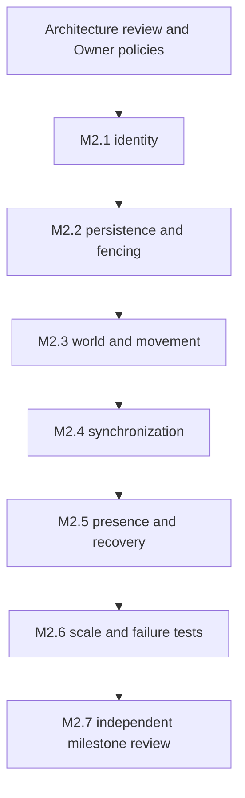

# M2 implementation plan — proposed, not started

Status: DESIGN ONLY. [M1 acceptance](M1_ACCEPTANCE.md) is PASS. This plan does not authorize implementation, database access, migrations, deployment or merge. Independent Gemini Architecture Review and Owner approval are required first.

## Gate D0 — approve design inputs

Review [architecture](M2_ARCHITECTURE.md), [confirmed game rules](GAME_RULES_REFERENCE.md), all [ADRs](adr/README.md) and [acceptance criteria](M2_ACCEPTANCE_CRITERIA.md). PO-01 is resolved: identity interfaces only, real Auth excluded from M2. Record remaining PO-02..PO-09 answers or explicit scope deferrals. Approve a local/non-production test target, schema compatibility inspection, workload/SLOs and the technical parameter registry. Missing gameplay policy blocks the affected feature; it is not filled with demo defaults.

Architecture review r0 must produce a new historical report via the Desktop workflow. Codex verifies findings, proposes bounded corrections and supplies a new saved package if required. Do not implement M2 while the architecture verdict/Owner decision gate remains open. Proposed ADRs become accepted only through that explicit decision record, not because this document is committed.

## M2.1 — identity and character ownership

After D0: implement Account ID, Player ID and Character ID types/ownership interfaces, plus an explicitly local/test identity adapter. Do not implement real Auth or login providers. Design supports an account owning multiple characters with no hardcoded quota. Selection/creation policy interfaces fail closed when unavailable; implement only Owner-approved policies. Public metadata only; no progression defaults. Test invalid/expired principal contexts, cross-account selection, ID confusion, policy/quota races when configured and ticket replay. Local identity fakes cannot become a deployed authentication fallback.

Exit evidence: two explicit fake trusted principals cannot control/read each other's private character data; distinct domain IDs survive reconnect; configured creation retries return one character/result. Report interface/local-test coverage honestly. Real JWT/Auth integration and public-user security acceptance remain NOT_IMPLEMENTED, outside M2.

## M2.2 — persistence and fenced ownership

Prepare conceptual-to-physical schema mapping against an approved local/non-production database. Inspect existing schemas/RLS/service triggers before proposing migration files. Implement account/player/character models, World Membership, world/map checkpoints, owner leases, control generations, idempotency and metadata outbox only after schema review. World Transition remains a policy/orchestration abstraction; no gameplay transfer is enabled without explicit approval. Production migration authorization is separate and absent here.

Test transaction races, owner expiry/pause/resume, stale checkpoint writes, duplicate redemptions, pool-mode behavior, failed commits and checkpoint rollback bounds. Do not rely on session advisory locks or connection-local auth state surviving transaction pooling.

Exit evidence: exactly one current authority per partition/character; stale writers are rejected at storage and routing boundaries; durability guarantees and limits match PO-06.

## M2.3 — world runtime, spawn and movement

Create shared runtime actors for the three approved world definitions with versioned maps and approved spawn policy. Keep one initial partition per enabled world unless topology approval changes. Implement bounded server-side random sampling and persist one result before visibility.

Resolve F-002 through ordered direction-event queues and piecewise integration inside fixed ticks, as proposed in ADR-0003. Technical frequency/lease/catch-up settings must be approved and measured; speed/geometry/rules come from approved gameplay/map configuration. No production defaults inferred from M1.

Exit evidence: same-world players share membership; cross-world privacy holds; brief press/release produces the correct symbolic elapsed displacement; client timestamps/spam cannot increase authoritative movement; reconnect does not reroll spawn.

## M2.4 — protocol v2 and player synchronization

Specify concrete message schemas from ADR-0006. Implement trusted-interface ticket admission in the approved local test scope, owner routing, initial full AOI snapshot, public entity enter/state/leave, separate received/applied/durable acknowledgements, input validation and bounded output queues. Real Auth remains excluded. Full snapshots first; deltas only when baseline/gap recovery is tested.

Exit evidence: browser clients see each other only where authorized; actor state is authoritative; repeated reconnect does not create another canvas or duplicate runtime entity; slow clients cannot cause unbounded queues.

## M2.5 — Redis presence and session recovery

Implement the approved key namespace, generation-aware compare/delete and stale-index pruning. Tickets and grants must remain replay-safe across Redis data loss/failover. Treat Pub/Sub gaps as resync conditions, not proof that every event arrived. Recover from owner memory or PostgreSQL checkpoints, never unverified Redis positions.

Exit evidence: dependency-loss, restart and delayed-cleanup scenarios meet the failure contract; previous sessions cannot delete a newer presence record or resume with old inputs.

## M2.6 — scale and fault validation

Use a local/non-production multi-process harness: at least two gateway processes routing to one owner for a shared partition; then distinct owners for separate partitions/worlds as approved. Starting several application workers must not duplicate authority. Test a paused old owner beyond expiry, network isolation, Redis restart, database outage and process death during admission/checkpoint.

Measure approved CCU/AOI workloads, tick/queue/checkpoint/network budgets and recovery behavior. No synthetic benchmark becomes a claim about production capacity. Cross-partition live handoff is a separately gated extension if not required by the approved M2 acceptance scope.

## M2.7 — milestone review

Run the complete related unit, integration, browser, authorization and failure suites against the exact saved inputs. Check secrets, compatibility and Git scope. Produce a sealed Desktop snapshot with full tracked/untracked content, diffs, manifest, inventory, actual results and limitations. Obtain independent Gemini review before any subsequent milestone. No automatic main merge or production deployment.

## Proposed dependency order

## Incremental Git workflow

Use meaningful completed units: implement → related tests/lint/typecheck → self-review/secrets → exact-path staging → Conventional Commit → normal push to `origin/tu` → verify remote SHA. Before each push, confirm branch/remote and stop if remote has new unknown history. No force push, amend/rebase of pushed history, empty contribution commits, blind `git add .`, main merge or deploy.

The current design task commits documentation only. M1 code/tests/locks, historical evidence, Supabase files and automation settings remain unchanged. Future code commits do not replace Independent Review.
