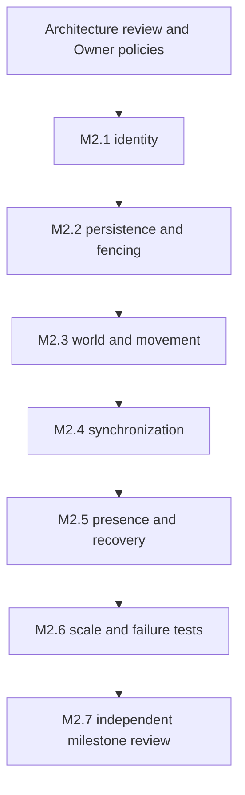

# M2 implementation plan — proposed, not started

Status: DESIGN ONLY. [M1 acceptance](M1_ACCEPTANCE.md) is PASS. This plan does not authorize implementation, database access, migrations, deployment or merge. Independent Gemini Architecture Review and Owner approval are required first.

Later Owner authorization enables only the [M2 Vertical Slice](M2_VERTICAL_SLICE.md): local/test server fixtures, one development world/partition, approved expiry/resync/release semantics and RAM-only lifetime, plus the explicitly approved sandbox/budget/fixture parameters. Its implementation/review is separate from the future full-M2 phases below. No PostgreSQL/Redis/Auth/transition phase is enabled; ADRs remain PROPOSED and other unresolved decisions pending.

Documentation history: R1 edited the three M2 documents and existing ADR-0001..0006 for NR-M2-001..008 on 2026-11-05. A separate authorized task then sealed R1 package `30899759-0943-4802-b63d-cc9f10b64d5d`; its immutable bytes remain historical evidence. R2 addresses advisory R1-001..003 within the existing whitelist and uses fix count 2/3. All ADRs remain PROPOSED. README, M1 source/tests, confirmed rules, policies and schemas remain outside the documentation edit scope. The phases below are future gated implementation work, not work executed during these revisions.

## Gate D0 — approve design inputs

Review [architecture](M2_ARCHITECTURE.md), [confirmed game rules](GAME_RULES_REFERENCE.md), all [ADRs](adr/README.md) and [acceptance criteria](M2_ACCEPTANCE_CRITERIA.md). PO-01 is resolved: identity interfaces only, real Auth excluded from M2. Record remaining PO-02..PO-09 answers or explicit scope deferrals. Approve a local/non-production test target, schema compatibility inspection, workload/SLOs and the technical parameter registry. Missing gameplay policy blocks the affected feature; it is not filled with demo defaults.

Independent Gemini architecture review must evaluate the exact saved inputs through the Desktop workflow. Codex verifies findings, makes Owner-authorized bounded corrections and supplies a separately authorized new saved package when requested. NONOFFICIAL advisory reviews do not satisfy the required Gemini 4 Argon review. Do not implement M2 while the architecture verdict/Owner decision gate remains open. Proposed ADRs become accepted only through that explicit decision record, not because this document is committed.

Owner authorization for each documentation/snapshot round is recorded in its handoff/provenance. [Architecture §14](M2_ARCHITECTURE.md#14-future-review-package-provenance--nr-m2-008) preserves the original design base/session, prior packages and shared fix budget. Historical M1/r0/r1 test evidence is context, not an execution against revised inputs. Fixture lifecycle/isolation, persistence target, held-input-after-expiry behavior, late-input policy and transaction/lease/queue/admission-latency/rate/recovery/revocation budgets remain pending.

## M2.1 — identity and character ownership

After D0: implement Account ID, Player ID and Character ID types/ownership interfaces, plus an explicitly local/test identity adapter. Do not implement real Auth or login providers. Design supports an account owning multiple characters with no hardcoded quota. Selection/creation policy interfaces fail closed when unavailable; implement only Owner-approved policies. Public metadata only; no progression defaults. Test invalid/expired principal contexts, cross-account selection, ID confusion, policy/quota races when configured and ticket replay. Local identity fakes cannot become a deployed authentication fallback.

NR-M2-002/006: select adapters only in the server composition root at startup. Build server-side principal fixtures; browser handles, if approved, are opaque and isolated by harness run and cannot activate test mode. Test request switching/production fallback denial. Revalidate current principal/account status and Account → Player → Character ownership at ticket redemption, not only at ticket issue; include membership/control/fence/version binding. Commit durable unique redemption with grant/result under the ADR-0004 matrix. Resolve uncertain/in-flight commit before any replacement grant/welcome; no Redis authorization fallback or external RPC within the transaction.

Exit evidence: two explicit fake trusted principals cannot control/read each other's private character data; distinct domain IDs survive reconnect; configured creation retries return one character/result. Report interface/local-test coverage honestly. Real JWT/Auth integration and public-user security acceptance remain NOT_IMPLEMENTED, outside M2.

## M2.2 — persistence and fenced ownership

Prepare conceptual-to-physical schema mapping against an approved local/non-production database. Inspect existing schemas/RLS/service triggers before proposing migration files. Implement account/player/character models, World Membership, world/map checkpoints, owner leases, control generations, idempotency and metadata outbox only after schema review. World Transition remains a policy/orchestration abstraction; no gameplay transfer is enabled without explicit approval. Production migration authorization is separate and absent here.

Test transaction races, owner expiry/pause/resume, stale checkpoint writes, duplicate redemptions, pool-mode behavior, failed commits and checkpoint rollback bounds. Do not rely on session advisory locks or connection-local auth state surviving transaction pooling.

NR-M2-003/005: map canonical membership identity/version into grants/checkpoints and implement the [proposed operation matrix](adr/0004-postgres-durability-and-fencing.md#operation-level-lock-matrix--nr-m2-005) only after reviewing target FK/index/trigger/isolation conflicts. Lock Account/Player/Character anchors before sorted lease sets and dependent rows; lease renewal/takeover transactions remain lease-only. Test overlapping batches, two first-spawn keys, reversed source/target handoffs, account/control changes, checkpoint/renewal contention and expired/uncertain renewal. Batch/transaction/wait/margin budgets require PO-06/07/08 approval; do not infer throughput from lock ordering.

R1-002: membership alone supplies canonical placement. Treat the repeated checkpoint/grant fields in the conceptual ER as constrained projections; test rejection of mismatched identity/version/full placement under P-09. Choose or alter no physical schema through this wording clarification. Approved physical join/projection or retained-column constraint/transaction enforcement must be reviewed separately before implementation.

Exit evidence: exactly one current authority per partition/character; stale writers are rejected at storage and routing boundaries; durability guarantees and limits match PO-06.

## M2.3 — world runtime, spawn and movement

Create shared runtime actors for the three approved world definitions with versioned maps and approved spawn policy. Keep one initial partition per enabled world unless topology approval changes. Implement bounded server-side random sampling and persist one result before visibility.

First-spawn preparation is tentative. Under character anchors, rediscover current membership; after all required locks revalidate authorization, policy/map revision, candidate and current fence. Commit membership/checkpoint/grant/operation/outbox and admission redemption together when applicable. Concurrent same/different keys cannot create a second placement or reroll a committed result. No starting world/realm or fixture geometry is inferred.

Resolve F-002 through ordered direction-event queues and piecewise integration inside fixed ticks, as proposed in ADR-0003. Technical frequency/lease/catch-up settings must be approved and measured; speed/geometry/rules come from approved gameplay/map configuration. No production defaults inferred from M1.

NR-M2-001 → 007 → 004 form one dependency: distinguish receipt/admission/integration; serialize bounded admission with `[a,b)` tick closure; preserve directional samples, renewals and expiry/idle gaps on one timeline; apply collision/bounds segment by segment. Transport ping never renews intent. Test admission-after-closure, exact-boundary expiry/renewal, stale sequences/generations, delayed validation and obstacle/turn/reversal traces. Late-input and physically-held-key resume policies remain PO-05 pending; freeze/resync if the timeline cannot be preserved rather than selecting defaults.

R1-001: make the observed receive-to-admission path event-driven between ticks, with admission as the next ordered input operation after bounded in-progress work/earlier events. Do not wait for a tick-end mailbox drain or batch threshold. Run T-11/T-12 through actual receive/decode/route/owner-ingress/admission with a controlled clock and independent tick loop, not manually injected admission timestamps. Record receive-to-admission latency and pending-age/depth/budget counters; delayed admission beyond an approved budget freezes/resyncs without backdating. PO-07/08 must approve latency, queue and metric settings; no threshold is selected. T-01 remains an arithmetic-only unit specification and cannot establish F-002 closure by itself.

Exit evidence: same-world players share membership; cross-world privacy holds; brief press/release produces the correct symbolic elapsed displacement; client timestamps/spam cannot increase authoritative movement; reconnect does not reroll spawn.

## M2.4 — protocol v2 and player synchronization

Specify concrete message schemas from ADR-0006. Implement trusted-interface ticket admission in the approved local test scope, owner routing, initial full AOI snapshot, public entity enter/state/leave, separate received/applied/durable acknowledgements, input validation and bounded output queues. Real Auth remains excluded. Full snapshots first; deltas only when baseline/gap recovery is tested.

Distinguish sample/renewal/ping messages and intent generation from transport/control generation. Raw socket observation does not earn an admission ACK; a renewal's timeline effect earns an applied ACK only after its interval closes. No buffered pre-expiry intent automatically resumes after recovery. Keep redemption revalidation consistent with M2.1/M2.2 and ADR-0001/0004/0005.

Exit evidence: browser clients see each other only where authorized; actor state is authoritative; repeated reconnect does not create another canvas or duplicate runtime entity; slow clients cannot cause unbounded queues.

## M2.5 — Redis presence and session recovery

Implement the approved key namespace, generation-aware compare/delete and stale-index pruning. Tickets and grants must remain replay-safe across Redis data loss/failover. Treat Pub/Sub gaps as resync conditions, not proof that every event arrived. Recover from owner memory or PostgreSQL checkpoints, never unverified Redis positions.

Exit evidence: dependency-loss, restart and delayed-cleanup scenarios meet the failure contract; previous sessions cannot delete a newer presence record or resume with old inputs.

## M2.6 — scale and fault validation

Use a local/non-production multi-process harness: at least two gateway processes routing to one owner for a shared partition; then distinct owners for separate partitions/worlds as approved. Starting several application workers must not duplicate authority. Test a paused old owner beyond expiry, network isolation, Redis restart, database outage and process death during admission/checkpoint.

Measure approved CCU/AOI workloads, tick/queue/checkpoint/network budgets and recovery behavior. No synthetic benchmark becomes a claim about production capacity. Cross-partition live handoff is a separately gated extension if not required by the approved M2 acceptance scope.

## M2.7 — milestone review

After future implementation and separate package authorization, run the complete related unit, integration, browser, authorization and failure suites against the exact saved inputs. Check secrets, compatibility and Git scope. Produce a sealed Desktop snapshot with full tracked/untracked content, original base/session, new package UUID/round/fix count, cumulative/incremental diffs, manifest and separate digest, inventory, actual results/tool provenance and limitations. Preserve prior packages/reports; distinguish historical evidence from authoritative evidence for new inputs and Codex-supplied hashes from independently verified hashes. Obtain independent Gemini review before any subsequent milestone. Documentation review snapshots follow their separately recorded Owner authorization; they are not implementation acceptance. No automatic main merge or production deployment.

## Proposed dependency order

## Incremental Git workflow

For an authorized unit, complete the scoped change → appropriate validation → self-review/secrets → exact-path staging → inspect `git diff --cached` and `--check` → Conventional Commit. Push normally to `origin/tu` only when explicitly authorized for that work, then verify remote SHA. Before each push, confirm branch/remote and stop if remote has new unknown history. No force push, amend/rebase of pushed history, empty contribution commits, blind `git add .`, main merge or deploy.

For each Owner-authorized documentation round, commit/push only the related files within the nine-document whitelist after checking combined consistency and staged scope. Validate links/ADR references, Mermaid syntax, unique acceptance IDs, PROPOSED status and preserved pending decisions. These document checks are not application/concurrency/Auth tests. M1 code/tests/locks, historical evidence, Supabase files, ADR README and automation settings remain unchanged. Snapshot creation follows explicit round authorization, creates a new immutable package and preserves old packages/reports. Stop at the authorized handoff for Owner/reviewer action. Future code commits do not replace Independent Review.
